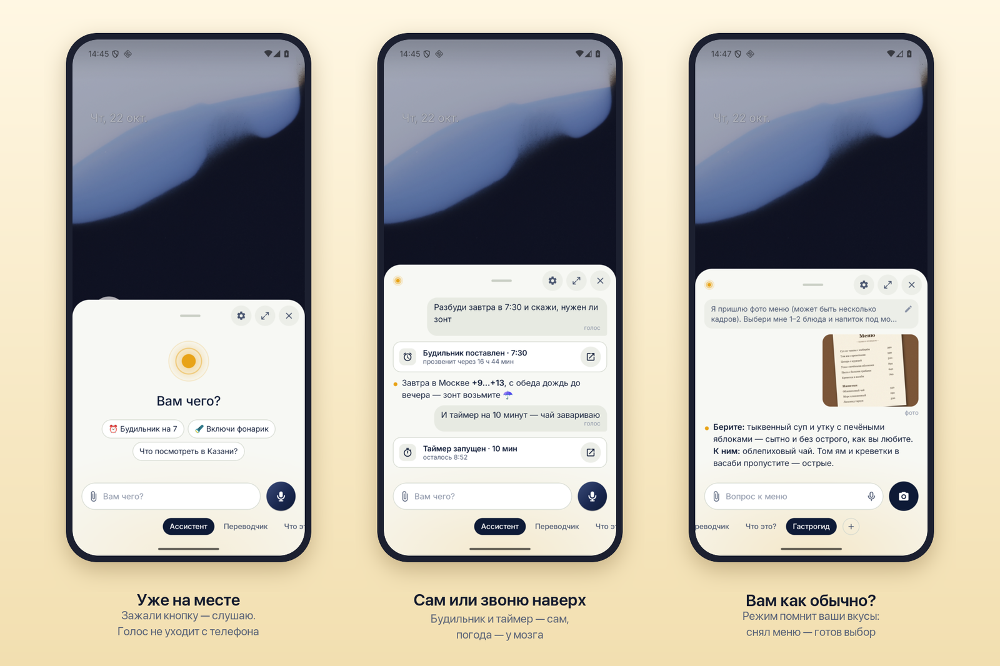

# Вахтёр — ни секунды лишней



**Зажал кнопку — сказал — готово.** Голосовой ассистент для Android вместо системного помощника: без запуска приложений, без промптов, без рекламы. Мозг выбираете вы.

> **Vahter** is an Android assistant built around one idea: no wasted seconds. Hold the side button, speak, done. Speech is recognized on the phone (GigaAM), simple commands run locally without network, everything else goes to the brain you choose — DeepSeek via API or your own [Hermes Agent](https://github.com/NousResearch/hermes-agent) server. No trackers. The interface is Russian for now. MIT license.

## Зачем

Каждый день мы тратим десятки секунд на одно и то же: найти приложение, открыть, напечатать вопрос, объяснить, чего хотим. Вахтёр убирает эти шаги:

- **без запуска приложения** — боковая кнопка открывает лист поверх любого экрана;
- **без печати** — речь распознаётся на самом телефоне и печатается по мере произнесения;
- **без промпта** — он уже в режиме: «Переводчик», «Что это?», «Гастрогид» или свой;
- **без ожидания** — будильник, таймер, фонарик телефон делает сам, даже без сети.

Будильник — одна фраза. «Что заказать?» — снимок меню. Перевод, справка по вывеске или товару — пара нажатий, ответ сразу.

## Как это устроено для человека

- **Лист поверх всего.** Зажали боковую кнопку — Вахтёр уже слушает. Отпустили — ушло. Вверх — запись без рук, влево — отмена.
- **Режимы** — вкладки, как в камере. У каждого режима свой промпт, главное действие (голос или камера) и свой мозг. Свои режимы — в пару касаний.
- **Голос не покидает телефон.** Распознавание — GigaAM v3 на устройстве; мозгу уходит только текст.
- **Мозг сменный.** DeepSeek напрямую по API (подойдёт любой OpenAI-совместимый) — с поиском в интернете и действиями телефона. Или свой агент Hermes на сервере — с памятью между днями (общей с Telegram), командами на сервере и файлами.
- **Последнее слово — за телефоном.** Действия на телефоне (будильник, календарь, звонок, сообщение…) — с правилом «Разрешено / Спрашивать / Не разрешено»; каждое оставляет строку в разговоре, где можно — с «Отменить». Всё, что уходит другим людям, — черновик: отправляет человек.
- **Никаких трекеров.** Ни аналитики, ни рекламы, ни сервисов Google. Сеть — только к выбранному мозгу и, по желанию, проверка обновлений на GitHub.

## Установка

1. Скачать APK из [Releases](https://github.com/poneslas/vahter/releases) и установить (Android 13+).
2. Первый запуск проведёт по шагам: скачать голос (225 МБ, один раз), выбрать Вахтёра цифровым помощником, подключить мозг.
3. Мозг: ключ [DeepSeek](https://platform.deepseek.com) — или приглашение со своего сервера Hermes (см. `server/`).

Дальше приложение само предлагает обновления в «О программе».

## Свой сервер Hermes

`server/` — всё, чтобы подключить телефоны к своему [Hermes Agent](https://github.com/NousResearch/hermes-agent):
- `server/skill/vahter/` — навык Hermes: приглашения для телефонов и их отзыв («сделай приглашение для Вахтёра для S24»);
- `server/host/` — Caddy перед API-сервером Hermes: ключи телефонов вместо ключа API, страница приглашения, приём файлов с телефона. Установка — `install.sh`, пути своего сервера — в `site.env` (образец — `site.env.example`).

## Для разработчиков

Kotlin, Jetpack Compose, без тяжёлых зависимостей: сеть — `HttpURLConnection`, распознавание — onnxruntime (телеметрия отключена), камера — CameraX.

```
./gradlew :app:assembleDebug          # отладочная: ru.poneslas.vahter.dev, ставится рядом с выпускной
./gradlew :app:testDebugUnitTest
./gradlew :app:assembleRelease        # выпускная: подпись из local.properties (vahter.release.*), ключ — вне репозитория
adb shell cmd role add-role-holder android.app.role.ASSISTANT ru.poneslas.vahter.dev
adb shell input keyevent KEYCODE_ASSIST   # открыть лист
```

Документы — в `docs/`:
- `Продукт.md` — что делаем: идея, принципы, сценарии, словарь интерфейса;
- `Архитектура.md` — как устроено: модули, голос, мозги, действия, правила платформы;
- `Бэклог.md` — журнал решений и открытые вопросы;
- `Проверки_на_устройстве.md` — проверки платформы на телефоне;
- `design/Прототип.html` — кликабельный прототип: спецификация интерфейса и поведения. Сначала меняется прототип, потом приложение. Код прототипа (`design/prototype/`) разложен по тем же границам, что приложение; проверка без браузера — `node tools/proto-check.mjs`.

Тексты интерфейса — `app/src/main/res/values/strings.xml` (русский — исходный); новый язык — копия в `values-xx/`. В коде — `tr(R.string.ключ)`, ключи по смыслу: `<область>_<суть>`, общие слова — `ui_*`.

Прочее: `tools/release/` — сборка выпуска (`update_json.py` — манифест обновлений), `tools/compare/` — одинаковые экраны прототипа и эмулятора парами, `tools/probe/` — пробник платформы (образец кода).

## Спасибо

- [GigaAM](https://github.com/salute-developers/GigaAM) (MIT) — распознавание речи (модель v3 в ONNX);
- [Гига Писарь для Android](https://github.com/moznoazachem/giga-pisar-android) (MIT) — запись и распознавание перенесены в `app/…/pisar/`;
- [Hermes Agent](https://github.com/NousResearch/hermes-agent) — агент на своём сервере;
- [onnxruntime](https://github.com/microsoft/onnxruntime) (MIT).

## Лицензия

[MIT](LICENSE).
